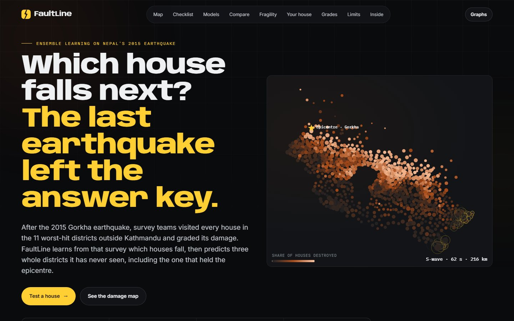
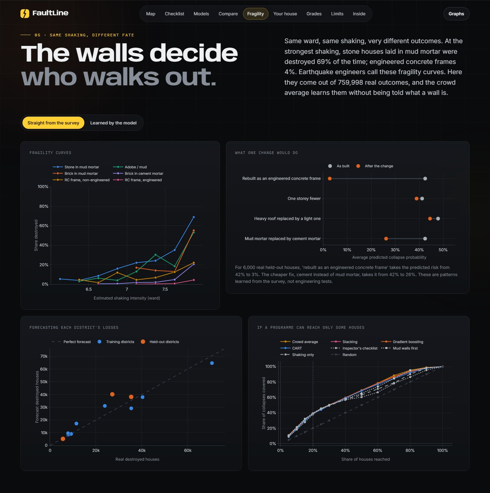
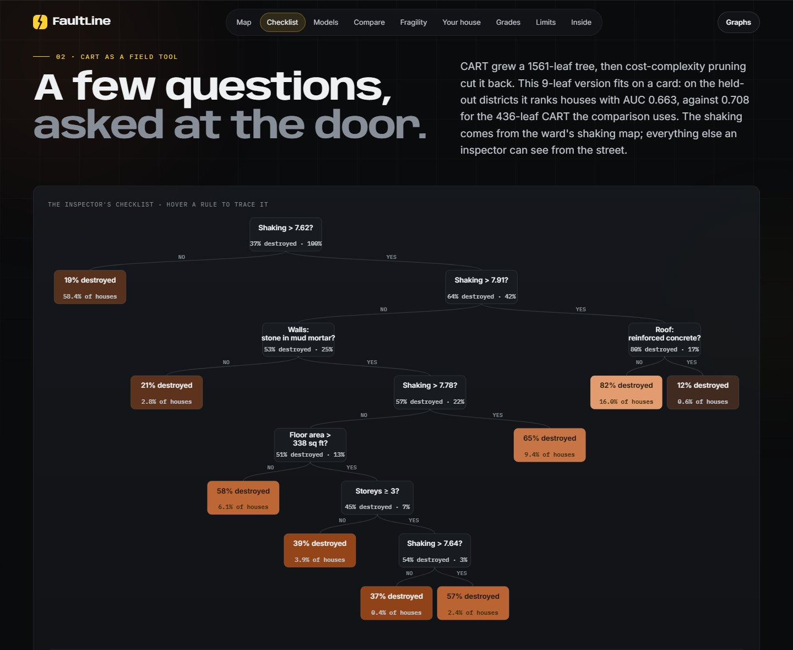
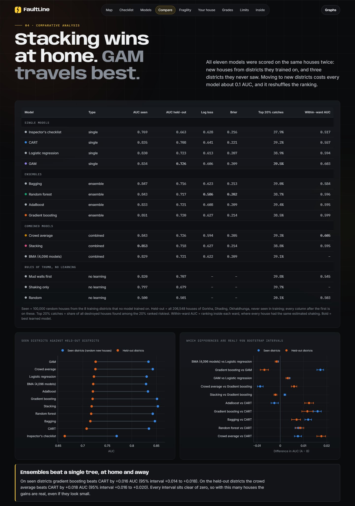
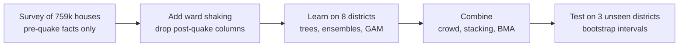
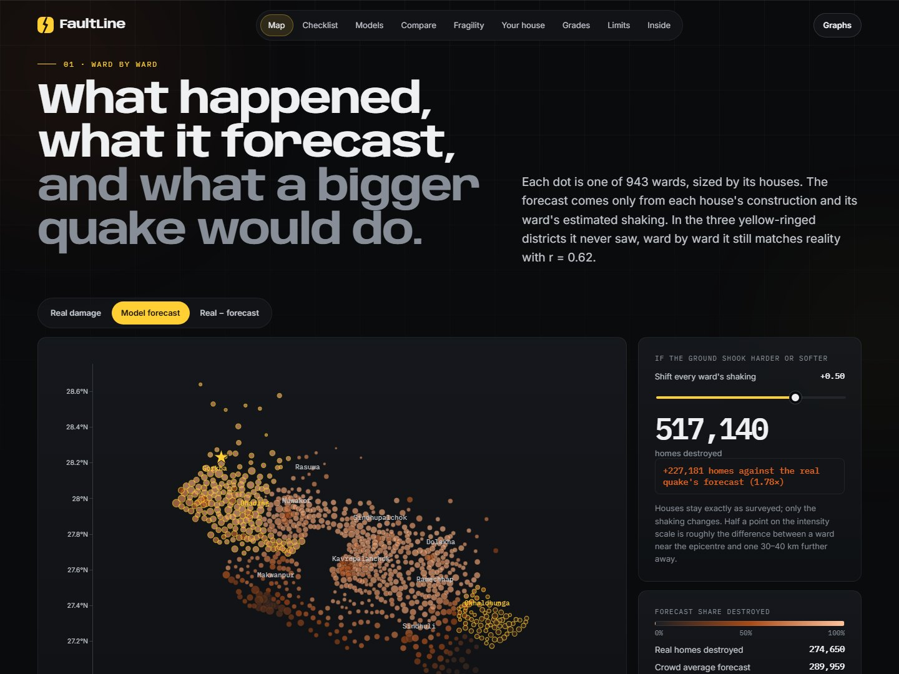
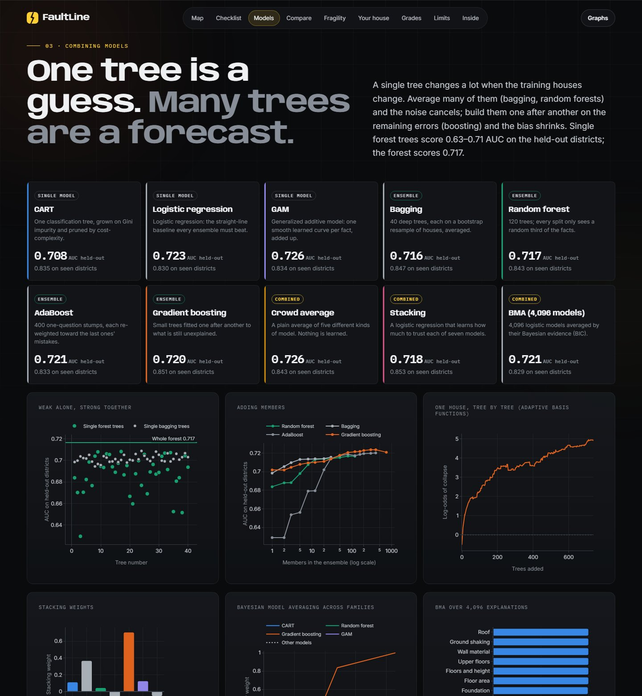
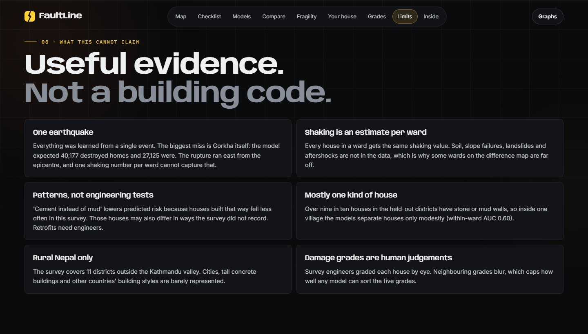

<div align="center">

# 🏚️ FaultLine

### Which house falls next? *The last earthquake left the answer key.*

**759,998 houses were graded by survey engineers after Nepal's 2015 Gorkha earthquake. FaultLine learns which ones fell,**<br>
**then predicts three whole districts it never saw, including the one that held the epicentre.**<br>
Trees, bagging, random forests, AdaBoost, gradient boosting, a GAM, stacking and Bayesian model averaging, all written from scratch in NumPy.




**Live demo:** [https://faultline.vercel.app](https://faultline.vercel.app)<br>
[The idea](#idea) · [Results](#results) · [The comparison](#compare) · [How it works](#how) · [Models](#models) · [What it cannot claim](#limits) · [Screenshots](#screenshots) · [Run it](#run)

</div>

---

## 📌 At a glance

| 🏠 Houses graded | 💥 Destroyed | 🗺️ Wards | 🚫 Districts never seen | 🧮 Models compared | 📊 Graphs explained |
|:---:|:---:|:---:|:---:|:---:|:---:|
| **759,998** | **274,650** | **943** | **3** | **10** | **47** |

---

<a id="idea"></a>
## 💡 The idea

Nepal sits on one of the most active faults on Earth, and another large earthquake is a matter of when. In 2015 the Gorkha earthquake (magnitude 7.8)
killed nearly 9,000 people. Money to strengthen houses, and engineers to inspect them, can only ever reach some homes, so the question is which ones first.

After the quake, survey teams visited every house in the 11 worst-hit districts outside the Kathmandu valley and recorded how it was built and how badly it was damaged,
on a scale from 1 (hairline cracks) to 5 (destroyed). That survey is an answer key. FaultLine asks:

> Given only what was true before the earthquake (walls, foundation, roof, storeys, age, size) and how hard the ground shook in each ward, can a model tell which houses will be destroyed?

To make the test honest, three whole districts (**Gorkha, Dhading, Okhaldhunga**) are kept out of training completely. Gorkha held the epicentre.

| | Who | What they get |
|:---:|---|---|
| 🏗️ | A reconstruction agency | Which houses and wards to strengthen or inspect first, and what each upgrade is likely to buy |
| 🚑 | A relief planner | A ward-by-ward loss forecast from a shaking map, in the first hours after a quake |
| 👷 | An engineer or mason | A printable checklist, and fragility curves learned from 759,998 real outcomes |

---

<a id="results"></a>
## 🔬 What it found

### Same shaking, different fate

Collapse rate by ward shaking intensity and main construction type, straight from the survey:

| Main construction | Houses | 6.12 | 6.38 | 6.62 | 6.88 | 7.12 | 7.38 | 7.62 | 7.88 |
|---|---:|---:|---:|---:|---:|---:|---:|---:|---:|
| Stone in mud mortar | 589,493 | 5% | 4% | 9% | 16% | 22% | 24% | 35% | 69% |
| Adobe / mud | 12,879 | – | 3% | 6% | 4% | 13% | 30% | 18% | 53% |
| Brick in mud mortar | 15,436 | – | – | – | – | 17% | 14% | 13% | 55% |
| Brick in cement mortar | 42,347 | – | – | 1% | 1% | 2% | 2% | 5% | 21% |
| RC frame, non-engineered | 29,945 | – | 5% | 2% | 12% | 5% | 7% | 13% | 22% |
| RC frame, engineered | 12,316 | – | – | 0% | – | 0% | 0% | 1% | 4% |

At the strongest shaking, **69% of stone houses laid in mud mortar were destroyed**; engineered concrete frames, 4%.
The combined model learns these curves without being told what a wall is (see the *Fragility* section of the site).



### What one change would do

For real houses in the held-out districts, change one fact and re-predict with the crowd average. These are patterns in the survey, not engineering tests.

| Change | Houses it applies to | Predicted risk before | After |
|---|---:|---:|---:|
| Mud mortar replaced by cement mortar | 6,000 | 42% | 26% |
| Heavy roof replaced by a light one | 6,000 | 48% | 44% |
| One storey fewer | 6,000 | 41% | 39% |
| Rebuilt as an engineered concrete frame | 6,000 | 42% | 3% |

### Forecasting the districts it never saw

Sum of predicted probabilities against the real count of destroyed houses:

| Held-out district | Houses | Mean shaking | Destroyed | Forecast | Error |
|---|---:|---:|---:|---:|---:|
| Okhaldhunga | 39,352 | 6.77 | 5,620 | 5,164 | -8% |
| Dhading | 89,122 | 7.64 | 35,346 | 38,127 | +8% |
| Gorkha | 78,074 | 7.75 | 27,125 | 40,177 | +48% |

Ward by ward in the held-out districts, the forecast matches the real share destroyed with r = 0.62.
Gorkha is the biggest miss: the rupture ran east from the epicentre, and one shaking estimate per ward cannot capture that.

### The inspector's checklist

CART grew a 1561-leaf tree. Cost-complexity pruning gives a whole family of smaller trees; the largest with at most 10 leaves fits on a card:

| Rule | If | Share of houses | Destroyed |
|:---:|---|---:|---:|
| A | Shaking > 7.91 · not Roof: reinforced concrete | 16.0% | **82%** |
| B | Shaking 7.78–7.91 · Walls: stone in mud mortar | 9.4% | **65%** |
| C | Shaking 7.62–7.78 · Walls: stone in mud mortar · Floor area ≤ 338 sq ft | 6.1% | **58%** |
| D | Shaking 7.64–7.78 · Walls: stone in mud mortar · Floor area > 338 sq ft · Storeys ≥ 3 | 2.4% | **57%** |
| E | Shaking 7.62–7.78 · Walls: stone in mud mortar · Floor area > 338 sq ft · Storeys ≤ 2 | 3.9% | **39%** |
| F | Shaking 7.62–7.64 · Walls: stone in mud mortar · Floor area > 338 sq ft · Storeys ≥ 3 | 0.4% | **37%** |
| G | Shaking 7.62–7.91 · not Walls: stone in mud mortar | 2.8% | **21%** |
| H | Shaking ≤ 7.62 | 58.4% | **19%** |
| I | Shaking > 7.91 · Roof: reinforced concrete | 0.6% | **12%** |



---

<a id="compare"></a>
## ⚖️ The comparison

Every model is scored on the same houses. *Seen* = 100,000 random houses from the 8 training districts that no model trained on.
*Held-out* = all 206,548 houses of Gorkha, Dhading, Okhaldhunga. All other columns are on the held-out districts.
*Top 20%* = share of all destroyed houses among the 20% ranked riskiest. *Within-ward AUC* = ranking inside each ward, where every house had the same shaking.

| Model | Type | AUC seen | AUC held-out | Log loss | Brier | Top 20% | Within-ward AUC |
|---|---|---:|---:|---:|---:|---:|---:|
| Inspector's checklist | Single models | 0.769 | 0.663 | 0.628 | 0.216 | 37.9% | 0.517 |
| CART | Single models | 0.835 | 0.708 | 0.641 | 0.221 | 39.2% | 0.557 |
| Logistic regression | Single models | 0.830 | 0.723 | 0.613 | 0.207 | 38.9% | 0.594 |
| **GAM** | Single models | 0.834 | 0.726 | 0.606 | 0.209 | 39.5% | 0.603 |
| Bagging | Ensembles | 0.847 | 0.716 | 0.623 | 0.213 | 39.0% | 0.584 |
| Random forest | Ensembles | 0.843 | 0.717 | 0.586 | 0.202 | 38.7% | 0.596 |
| AdaBoost | Ensembles | 0.833 | 0.721 | 0.608 | 0.209 | 39.4% | 0.595 |
| Gradient boosting | Ensembles | 0.851 | 0.720 | 0.627 | 0.214 | 38.5% | 0.599 |
| Crowd average | Combined | 0.843 | 0.726 | 0.594 | 0.205 | 39.3% | 0.605 |
| **Stacking** | Combined | 0.853 | 0.718 | 0.627 | 0.214 | 38.8% | 0.595 |
| BMA (4,096 models) | Combined | 0.829 | 0.721 | 0.622 | 0.209 | 39.1% | – |
| Mud walls first | No learning | 0.820 | 0.707 | – | – | 39.8% | 0.545 |
| Shaking only | No learning | 0.797 | 0.679 | – | – | 39.7% | – |
| Random | No learning | 0.500 | 0.501 | – | – | 20.1% | 0.503 |

Paired bootstrap (300 resamples of 50,000 houses) for the differences that matter:

| Comparison (A vs B, AUC of A − B) | Seen districts | Held-out districts |
|---|---|---|
| Crowd average vs CART | +0.008 (95% interval +0.006 to +0.009) | +0.018 (95% interval +0.016 to +0.020) |
| Random forest vs CART | +0.008 (95% interval +0.006 to +0.009) | +0.009 (95% interval +0.007 to +0.010) |
| Bagging vs CART | +0.012 (95% interval +0.011 to +0.013) | +0.007 (95% interval +0.005 to +0.009) |
| Gradient boosting vs CART | +0.016 (95% interval +0.014 to +0.018) | +0.012 (95% interval +0.009 to +0.014) |
| AdaBoost vs CART | −0.003 (95% interval −0.004 to −0.001) | +0.012 (95% interval +0.011 to +0.014) |
| Stacking vs Gradient boosting | +0.002 (95% interval +0.002 to +0.002) | −0.002 (95% interval −0.003 to −0.001) |
| Crowd average vs Gradient boosting | −0.009 (95% interval −0.010 to −0.007) | +0.006 (95% interval +0.005 to +0.007) |
| GAM vs Logistic regression | +0.004 (95% interval +0.003 to +0.004) | +0.003 (95% interval +0.002 to +0.004) |
| Gradient boosting vs GAM | +0.017 (95% interval +0.016 to +0.019) | −0.007 (95% interval −0.009 to −0.005) |
| BMA (4,096 models) vs Logistic regression | −0.001 (95% interval −0.001 to −0.001) | −0.002 (95% interval −0.002 to −0.001) |

**What the comparison shows**

1. **Ensembles beat a single tree, at home and away.** On seen districts gradient boosting beats CART by +0.016 (95% interval +0.014 to +0.018); on the held-out districts the crowd average beats CART by +0.018 (95% interval +0.016 to +0.020).
2. **Learned combination weights do not travel.** Stacking is the best model at home (0.853) but falls behind plain boosting on the held-out districts by −0.002 (95% interval −0.003 to −0.001). The crowd average learns nothing and travels best (0.726).
3. **Smooth models generalise.** The GAM beats logistic regression by +0.003 (95% interval +0.002 to +0.004) on the held-out districts, and is ahead of gradient boosting there.
4. **Bayesian model averaging chooses rather than averages.** Across model families it puts 100.0% of the weight on Gradient boosting. Over all 4,096 logistic explanations, 3 models hold 99% of the weight; its inclusion probabilities say the survey needs ground shaking, floors and height, floor area, wall material, foundation, roof, upper floors, and not age, ground slope, ground floor, position, plan shape.
5. **Where the ground shook explains most of it.** Without the shaking estimate, gradient boosting falls from 0.720 to 0.606 AUC on the held-out districts, and ranking by shaking alone already finds 39.7% of collapses in the top 20%. Inside a ward the crowd average still ranks houses better than "mud walls first" (0.605 against 0.545), but the margin is modest because over nine in ten held-out houses have stone or mud walls.



### Five damage grades

The same facts sorted into all five grades. On the held-out districts a multi-class CART (527 leaves) is exactly right for 38% of houses and within one grade for 74%;
always guessing the most common grade gets 33% exact. A five-class random forest reaches 38% and 74%.

---

<a id="how"></a>
## ⚙️ How it works



Columns recorded after the earthquake (post-quake storeys and height, condition, the technical solution proposed) would leak the answer, so they are removed. The target is damage grade 5.

**CART** splits on the question that most reduces Gini impurity, then **cost-complexity pruning** collapses the weakest link again and again:

```math
G(t) = 1 - \sum_k p_k^2, \qquad g(t) = \frac{R(t) - R(T_t)}{|\tilde T_t| - 1}
```

**AdaBoost** re-weights houses after every one-question stump, and **gradient boosting** fits each new regression tree to the residuals, with Newton-step leaves.
Both are **adaptive basis function models**, a weighted sum of learned pieces:

```math
f(x) = w_0 + \sum_{m=1}^{M} w_m \, \phi_m(x), \qquad \alpha_m = \tfrac12 \ln \frac{1 - \text{err}_m}{\text{err}_m}
```

The **GAM** gives every number its own smooth curve (cubic P-splines), fitted by local scoring and backfitting, so every prediction splits into one contribution per fact:

```math
\text{logit}\, p(x) = \alpha + \sum_j f_j(x_j), \qquad \text{penalty} = \lambda \sum (\Delta^2 \beta)^2
```

**Stacking** learns weights on the base models' log-odds using validation houses; the **crowd** just averages five model families.
**Bayesian model averaging** weights all $2^{12} = 4096$ logistic models by $p(M \mid D) \propto \exp(-\text{BIC}_M / 2)$, and across model families by held-out likelihood.

---

<a id="models"></a>
## 🧮 Models

Every model is written from its equations in NumPy. scikit-learn appears only in the test suite.

| Model | Role | File |
|---|---|---|
| **CART** | Gini splits over quantile bins, cost-complexity pruning, the checklist and the five-grade tree | [`tree.py`](backend/tree.py) |
| **Bagging** and **random forest** | Bootstrap trees, random feature subsets, out-of-bag error, multi-class | [`ensemble.py`](backend/ensemble.py) |
| **AdaBoost** | Discrete AdaBoost on stumps | [`ensemble.py`](backend/ensemble.py) |
| **Gradient boosting** | Log-loss boosting with Newton leaves, subsampling and early stopping | [`ensemble.py`](backend/ensemble.py) |
| **Stacking** and **crowd** | Logistic stacker on validation log-odds; a plain average | [`ensemble.py`](backend/ensemble.py), [`combine.py`](backend/combine.py) |
| **GAM** | Logistic GAM with P-splines, local scoring and backfitting | [`gam.py`](backend/gam.py) |
| **Logistic regression** | IRLS (Newton's method), the baseline and the BMA building block | [`linear.py`](backend/linear.py) |
| **Bayesian model averaging** | All 4,096 subsets by BIC, and across model families | [`bma.py`](backend/bma.py) |
| **Scoring** | AUC, average precision, log loss, Brier, calibration, paired bootstrap | [`metrics.py`](backend/metrics.py) |

**Data.** The 2015 Nepal earthquake building survey, published through the government and Kathmandu Living Labs open data portal, via
[Nepal Earthquake: Ward-Level Intensities and Impact](https://www.kaggle.com/datasets/sirorororo/nepal-earthquake-ward-level-intensities-and-impact) on Kaggle,
which also supplies the estimated shaking intensity for each ward. 759,998 houses in 943 wards; 3,144 houses with an unrecorded age (code 999) get the median age and an "age not recorded" flag.

---

<a id="limits"></a>
## 🚧 What it cannot claim

| Limit | Detail |
|---|---|
| **One earthquake** | Everything is learned from a single event. Gorkha was over-forecast: 40,177 destroyed homes expected, 27,125 real. |
| **Shaking is one estimate per ward** | Soil, slope failures, landslides and aftershocks are not in the data, so some wards on the difference map are far off. |
| **Patterns, not engineering tests** | "Cement instead of mud" lowers predicted risk because such houses fell less often here. They may differ in ways the survey did not record. |
| **Mostly one kind of house** | Over nine in ten held-out houses have stone or mud walls, so within one village the models separate houses only modestly. |
| **Rural Nepal only** | The survey covers districts outside the Kathmandu valley. Cities and tall concrete buildings are barely represented. |
| **Grades are human judgements** | Engineers graded each house by eye, and neighbouring grades blur. |

---

<a id="screenshots"></a>
## 🖼️ Screenshots

| | |
|:---:|:---:|
| <br>**Forecast map, with a stronger quake** | <br>**Where reality beat or missed the forecast** |
| <br>**Describe a house: every model votes** | <br>**Combining models** |
| <br>**What it cannot claim** | <br>**47 training graphs, each explained** |

---

<a id="run"></a>
## ▶️ Run it

```bash
git clone https://github.com/krishkavin7512/FaultLine.git
cd FaultLine
python -m venv .venv
.venv/Scripts/activate        # on macOS or Linux: source .venv/bin/activate
pip install -r requirements.txt
python run.py                 # opens http://127.0.0.1:8005
```

Trained results are included, so it starts straight away. Useful extras:

```bash
python run.py --retrain       # retrain everything, about 16 minutes
pip install -r requirements-dev.txt   # test tools: pytest, scikit-learn
python -m pytest tests -q     # 30 tests
```

The tests check the from-scratch AUC, tree splits, logistic regression and gradient boosting against scikit-learn, check that pruning paths are nested, that forests beat single trees and the GAM
recovers a curve a straight line cannot, that BMA finds planted signal, that one house encodes exactly like the training data, and every API route on the real trained models.

```
backend/   tree  ensemble  gam  linear  bma  metrics  combine  data  train  charts  api  config
frontend/  index.html  graphs.html  assets/
artifacts/ model.json  report.json  graphs.json
data/      buildings.csv.gz  wards.csv
tests/     test_from_scratch.py  test_api.py
```

---

## 🗺️ Where it could go

- Add soil, slope and landslide maps, which the ward shaking estimate cannot see
- Train on more than one earthquake, so the model learns what changes between events
- Predict the five grades with ordinal models that know grade 4 sits between 3 and 5
- Turn the checklist into a phone form for survey teams

---

## 📄 Licence and credits

Code is under the [MIT License](LICENSE) © 2026 Kavin Krish. Data: the 2015 Nepal earthquake building survey (Government of Nepal and Kathmandu Living Labs open data portal),
via [Kaggle](https://www.kaggle.com/datasets/sirorororo/nepal-earthquake-ward-level-intensities-and-impact), listed there under CC BY 4.0 by the uploader. The original portal's own licence terms could not be checked because it is offline.
